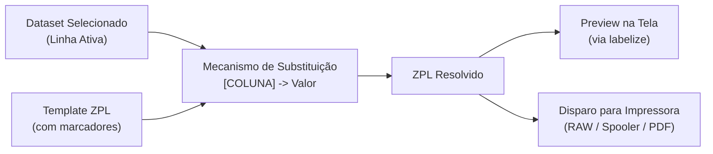

# Priqi — Documentação do Projeto

O **Priqi** é uma aplicação desktop leve, ágil e focada, desenvolvida em **Rust** com o framework **[iced](https://github.com/iced-rs/iced)**, projetada para resolver um fluxo direto e essencial: **selecionar dados a partir de uma fonte (dataset) e imprimir etiquetas industriais/comerciais (ZPL) com rapidez e sem atritos.**

---

## 1. Visão e Filosofia do Projeto

O objetivo final do Priqi é a **simplicidade operacional máxima**:
> O operador ou usuário abre o aplicativo, escolhe o conjunto de dados (ou importa um arquivo), seleciona o modelo de etiqueta desejado, define a quantidade e clica em **Imprimir**.

A ferramenta elimina a complexidade excessiva de softwares pesados de etiquetagem, entregando:
- Interface limpa, responsiva e moderna.
- Editor integrado com destaque de sintaxe ZPL e identificação visual de campos dinâmicos `[...]`.
- Pré-visualização gráfica fiel da etiqueta antes do disparo para o dispositivo.
- Integração direta entre colunas tabulares e variáveis do modelo ZPL.

---

## 2. Estado Atual do Projeto

| Módulo | Status | O que já está pronto |
| :--- | :---: | :--- |
| **Interface Geral & Janela** | Concluído | Janela *frameless* customizada, barra de título com controles de janela (minimizar, maximizar, fechar), fundo dinâmico em canvas (`DotGrid`), fontes e ícones Lucide integrados. |
| **Datasets (Tabela de Dados)** | Parcial | Exibição em tabela com navegação horizontal/vertical, filtro/busca por texto, seleção de linha, adição de colunas/linhas, edição inline de células e cabeçalhos em memória, modal de importação (UI). |
| **Templates (Modelos ZPL)** | Parcial | Listagem em cards com miniaturas gráficas simuladas, criação, duplicação, renomeação, exclusão de templates, modal de importação (UI). |
| **Editor ZPL** | Parcial | Text editor com numeração de linhas, parser de syntax highlighting customizado para comandos ZPL e marcadores de dados entre colchetes (`[...]`), sincronização bidirecional em memória com o template selecionado. Aba de preview com placeholder visual. |
| **Controles de Impressão** | Parcial | Card inferior flutuante e retrátil, seletor de impressora (*Térmica 80mm*, *Laser Escritório*, *Salvar em PDF*), slider de cópias e botão de impressão (UI montada). |
| **Banco de Dados (Persistência)** | Pendente | As dependências `sqlx` (com SQLite) e `tokio` já estão no `Cargo.toml`, mas os dados ainda estão em memória (`Default::default()`). |
| **Preview Real de ZPL** | Pendente | A dependência `labelize` já está adicionada; falta plugar o renderizador de ZPL para imagem no container de preview. |
| **Motor de Impressão** | Pendente | Falta implementar a rotina de envio de bytes RAW para o spooler/porta de impressora ou exportação para arquivo PDF. |

---

## 3. Definição do Banco de Dados (SQLite Simples)

Para manter a premissa de um projeto enxuto e sem complexidade desnecessária, o banco de dados SQLite local conterá **apenas duas tabelas**:

```
+-----------------------------------------------------------+
|                      priqi.db (SQLite)                    |
+-----------------------------+-----------------------------+
|         datasets            |          templates          |
+-----------------------------+-----------------------------+
| id          TEXT PRIMARY    | id          TEXT PRIMARY    |
| name        TEXT NOT NULL   | name        TEXT NOT NULL   |
| headers     TEXT (JSON)     | zpl         TEXT NOT NULL   |
| rows        TEXT (JSON)     | created_at  DATETIME        |
| updated_at  DATETIME        | updated_at  DATETIME        |
+-----------------------------+-----------------------------+
```

### 3.1. DDL das Tabelas

```sql
-- 1. Tabela de Datasets (fontes de dados tabulares arbitrárias)
CREATE TABLE IF NOT EXISTS datasets (
    id TEXT PRIMARY KEY NOT NULL,
    name TEXT NOT NULL,
    headers TEXT NOT NULL,     -- Array JSON de strings: ["SKU", "DESCRICAO", "LOTE"]
    rows TEXT NOT NULL,        -- Matriz JSON de strings: [["A01", "Parafuso", "L-90"], ...]
    created_at DATETIME NOT NULL DEFAULT CURRENT_TIMESTAMP,
    updated_at DATETIME NOT NULL DEFAULT CURRENT_TIMESTAMP
);

-- 2. Tabela de Modelos de Etiqueta (código ZPL)
CREATE TABLE IF NOT EXISTS templates (
    id TEXT PRIMARY KEY NOT NULL,
    name TEXT NOT NULL,
    zpl TEXT NOT NULL,
    created_at DATETIME NOT NULL DEFAULT CURRENT_TIMESTAMP,
    updated_at DATETIME NOT NULL DEFAULT CURRENT_TIMESTAMP
);
```

### 3.2. Por que essa modelagem é ideal?
- **Zero fricção com esquemas dinâmicos:** Cada dataset pode ter um conjunto arbitrário de colunas sem necessidade de migrações complexas ou criação de tabelas dinâmicas.
- **Serialização direta:** Mapeia de forma 1:1 com as estruturas Rust já existentes no projeto (`TableData { headers: Vec<String>, rows: Vec<Vec<String>> }` e `Template { id, name, zpl }`) via `serde_json`.
- **Facilidade de backup/migração:** O arquivo `.db` fica local na pasta de dados do usuário e pode ser facilmente exportado ou resetado.

---

## 4. Fluxo de Execução: Merge de Dados e Impressão (Data Binding)

O mecanismo central de funcionamento do Priqi segue três passos simples:



1. **Leitura do Template:** O código ZPL contém tags como `[COD_BARRAS]`, `[DESCRICAO]`, `[LOTE]`.
2. **Substituição (Merge):** O sistema pega a linha selecionada na tabela do dataset atual e substitui cada ocorrência `[NOME_COLUNA]` pelo valor correspondente daquela coluna.
3. **Renderização / Saída:** 
   - No **Preview**: O ZPL resultante é processado pelo `labelize` gerando a imagem de conferência.
   - Na **Impressão**: O ZPL resultante é multiplicado pelo número de cópias e despachado para a impressora.

---

## 5. Checklist para Conclusão do Projeto

### Fase 1: Persistência com SQLite (`sqlx`)
- [x] Inicialização da base SQLite local (`priqi.db`) ao abrir o aplicativo.
- [x] Execução das migrações/criação das tabelas `templates` e `datasets`.
- [x] Implementação de queries de CRUD simples para `templates` (salvar, listar, atualizar, deletar).
- [x] Implementação de queries de CRUD simples para `datasets` (salvar tabela atual, carregar, deletar).
- [x] Sincronizar o salvamento automático ao editar templates ou datasets na interface.

### Fase 2: Integração do Preview Real (`labelize`)
- [x] Implementar a função de geração de imagem a partir do ZPL usando o crate `labelize`.
- [x] Conectar a linha selecionada do dataset ao ZPL no preview (substituindo os tokens `[...]`).
- [x] Substituir o placeholder do `preview_frame.rs` por um widget `image` real com renderização da etiqueta.

### Fase 3: Importação de Dados e Arquivos
- [x] Finalizar o handler de importação de CSV real (converter texto colado em `TableData`).
- [x] Finalizar o handler de importação de código ZPL para novo template.

### Fase 4: Mecanismo de Impressão e Seleção Múltipla
- [x] Seleção múltipla de linhas na tabela de datasets com checkboxes individuais e botão "Selecionar Tudo".
- [x] Indicador visual da quantidade de linhas selecionadas com botão rápido de limpar seleção.
- [x] Loop de impressão gerando batch de etiquetas (substituindo placeholders para cada linha selecionada multiplicada pelas cópias).
- [x] Implementar envio de código ZPL RAW em arquivo de spool (`priqi_print_output.zpl`) para impressoras térmicas/laser.
- [x] Implementar opção de exportar imagens das etiquetas para `./output_labels/` ("Salvar em PDF/Imagem").
- [x] Feedback visual de status no botão de impressão (sucesso ou erro).

### Fase 5: Usabilidade e Polimento
- [x] Tratamento de erros amigável (avisos visuais quando o ZPL falhar na renderização).
- [x] Limpeza de warnings e validação rigorosa com `cargo check` e `cargo clippy`.
